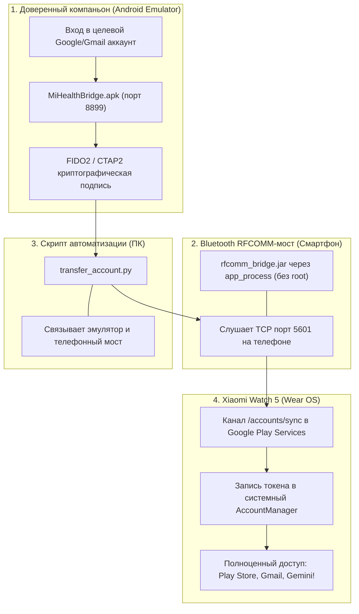

# 👑 Kaiser Gemini & Google Account Suite for Xiaomi Watch 5

[](https://github.com/kaiser10669-svg)
[](https://github.com/kaiser10669-svg)
[](https://github.com/kaiser10669-svg)
[](https://github.com/kaiser10669-svg)
[](LICENSE)

> [!NOTE]
> **Универсальный программный комплекс от Kaiser Dev**  
> Полный набор утилит и пошаговое руководство для **переноса любых Google-аккаунтов (Gmail)**, **повторной авторизации после смены пароля Google**, и **моментальной активации голосового ассистента Google Gemini** на часах **Xiaomi Watch 5**, **Watch 2 / Watch 2 Pro** без сброса к заводским настройкам (Zero-Reset).

---

## 🧭 Какие проблемы решает этот комплекс?

1. **Добавление второго (или третьего) Google-аккаунта (Gmail):**  
   Штатное приложение Mi Fitness не имеет механизма Google DirectTransfer. При попытке добавить аккаунт через часы на экране появляется бесконечное *«Продолжите на телефоне»*. Наш комплекс позволяет добавить любой Gmail-аккаунт (личный, рабочий, для Play Маркета).
2. **Повторная авторизация после смены пароля от Google / Gmail:**  
   Если вы изменили пароль от своей учетной записи Google или включили двухфакторную аутентификацию, на часах аккаунт переходит в статус ошибки авторизации. Так как Mi Fitness не поддерживает передачу учетных данных, восстановить доступ без полного сброса часов раньше было невозможно. Данный комплекс генерирует новый доверенный FIDO2-токен и обновляет сессию за 1 минуту!
3. **Первичное добавление аккаунта при сбое начальной настройки:**  
   Если часы были настроены без Google-аккаунта (например, на смартфонах без полноценных Google-сервисов).
4. **Активация Google Gemini (Google Assistant):**  
   Разблокировка и запуск голосового помощника Gemini с поддержкой русского языка и голосового ввода через микрофон часов.

---

## 🔬 Архитектура и технический принцип работы



1. **Bluetooth RFCOMM Transport:** Служба Google Play Services (GMS) на часах слушает сервисный UUID `5e8945b0-9525-11e3-a5e2-0800200c9a66`. Легковесный мост `rfcomm_bridge.jar` на телефоне перенаправляет этот канал на локальный TCP-порт `5601`.
2. **DirectTransfer FIDO2:** В официальном эмуляторе Android Studio приложение `MiHealthBridge.apk` запрашивает токен аутентификации от имени доверенного компаньона, подписывает его и передает по каналу `/accounts/sync` на часы.
3. **Gemini RPC (Поле 11 Protobuf):** Активация Gemini требует отправки вызовов `/assistant/psk` и `/assistant/activate` с установленным скрытым флагом `field 11 = 1` (`is_request = True`), что переводит ассистент в статус `ActivationState: 0 (Active)`.

---

## 📦 Состав репозитория

| Файл / Инструмент | Назначение |
| :--- | :--- |
| **`MiHealthBridge.apk`** | Специальный companion-агент (AOSP signed) для эмулятора, генерирующий FIDO2-токены аккаунта. |
| **`rfcomm_bridge.jar`** | Легковесный мост Bluetooth RFCOMM → TCP для смартфона (запуск через системный `app_process`, root не требуется). |
| **`start_phone_bridge.bat`** | Скрипт автоматической загрузки и запуска моста на телефоне в один клик. |
| **`transfer_account.py`** | Скрипт прямого переноса Google-аккаунта и обновления сессии при смене пароля. |
| **`run_account_transfer.bat`** | Интерактивный bat-файл для запуска переноса Google-аккаунта. |
| **`activate_gemini.py`** | Скрипт моментальной активации голосового ассистента Google Gemini. |
| **`run_gemini_activation.bat`** | Интерактивный запуск активации Gemini в один клик. |
| **`tools/`** | Автономный портативный ADB (драйверы и библиотеки включены). |

---

## 🚀 Пошаговое руководство

### ШАГ 1: Подготовка эмулятора с Gmail
1. В **Android Studio** откройте *Device Manager* и запустите эмулятор с поддержкой Google Play (например, **Pixel 8** или **Pixel 9a**, Android 14/15).
2. Внутри эмулятора зайдите в *Настройки → Google / Аккаунты* и **войдите под тем Gmail-аккаунтом**, который нужно перенести (или пароль которого вы сменили).
3. Задайте PIN-код экрана в эмуляторе (например, `1234`):
   ```cmd
   adb -s emulator-5554 shell locksettings set-pin 1234
   ```
4. Установите приложение `MiHealthBridge.apk` в эмулятор:
   ```cmd
   adb -s emulator-5554 install -r MiHealthBridge.apk
   ```
5. Пробросьте порт связи:
   ```cmd
   adb -s emulator-5554 forward tcp:8899 tcp:8899
   ```
6. Откройте приложение **MiHealthBridge** на экране эмулятора (оно перейдет в режим ожидания).

---

### ШАГ 2: Запуск Bluetooth-моста на телефоне
1. Подключите телефон к компьютеру по отладке (USB или Wi-Fi).
2. Узнайте Bluetooth MAC-адрес часов (он отображается в приложении Mi Fitness или свойствах Bluetooth, например `AA:BB:CC:DD:EE:FF`).
3. Запустите скрипт **`start_phone_bridge.bat`**:
   * Укажите IP/Serial телефона и MAC часов.
   * Скрипт автоматически запустит процесс `com.kaiserdev.rfcomm.RfcommBridge`.
   * В консоли отобразится: `Listening on TCP port 5601...`

---

### ШАГ 3: Перенос аккаунта на часы
1. На часах включите *«Отладку по Wi-Fi»* в меню разработчика и посмотрите IP часов.
2. Запустите **`run_account_transfer.bat`**:
   * Введите адрес вашей почты (например, `example@gmail.com`).
   * Введите IP телефона (где запущен порт 5601).
   * Введите IP:порт часов (например, `192.168.1.57:5555`).
3. **Результат:**
   * Скрипт согласует канал связи, автоматически введет PIN-код в эмуляторе и передаст FIDO2 токен.
   * На экране часов появится системное уведомление: **«Аккаунт добавлен»**!
   * Зайдите на часах в *Настройки → Google → Аккаунты* — ваш Gmail успешно добавлен и активен.

---

### ШАГ 4: Активация Google Gemini
Если на часах уже добавлен Google-аккаунт, активируйте Gemini:
1. Запустите **`run_gemini_activation.bat`**.
2. Скрипт отправит RPC-вызовы `/assistant/psk` и `/assistant/activate` с флагом `is_request=True`.
3. Через 5 секунд статус переключится в `ActivationState: 0 (Active)`.
4. На часах откроется полноценный рабочий экран Google Gemini с поддержкой русского языка!

---

## ❓ Часто задаваемые вопросы (FAQ)

<details>
<summary><b>Что делать, если я сменил пароль от Gmail?</b></summary>
Просто повторите процедуру из инструкции (ШАГ 1, 2 и 3): войдите в эмуляторе с новым паролем и запустите скрипт переноса. Новый токен перезапишет устаревший на часах, и аккаунт снова заработает без сброса часов!
</details>

<details>
<summary><b>Сколько аккаунтов можно добавить на часы?</b></summary>
Ограничений со стороны Wear OS нет: вы можете добавить несколько личных и рабочих аккаунтов, повторяя процедуру для каждого нужного email.
</details>

<details>
<summary><b>Нужен ли Root на часах или телефоне?</b></summary>
Нет! Мост на телефоне запускается через стандартный системный <code>app_process</code> по ADB, а на часах используются официальные каналы Wearable DirectTransfer.
</details>

---

## 👑 Авторство
* **Автор решения и комплекта:** [Kaiser Dev](https://github.com/kaiser10669-svg)
* Разработано специально для сообщества 4PDA и владельцев устройств Wear OS.
